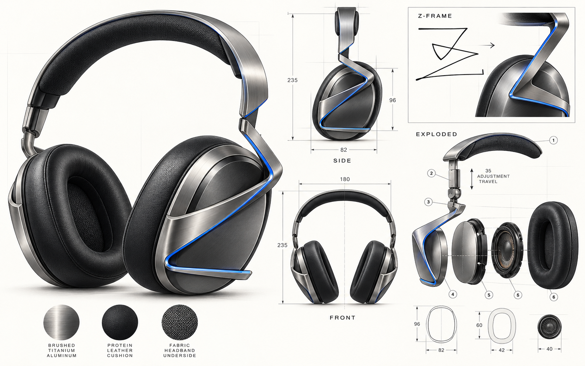

# Z-FRAME 耳机概念系列

以一笔交叉折线为灵感的耳机产品家族。原始笔迹的“水平起笔—斜向交叉—弧形转折—水平收尾”被转化为耳罩或耳挂外侧的 Z 形支臂。它既是识别度最高的造型元素，也承担连接头梁、转轴和声学单元的结构任务。



## 在线浏览

打开仓库根目录的 [`index.html`](index.html) 即可离线浏览完整中文产品介绍。若启用 GitHub Pages，可把仓库根目录作为发布来源。

## 四个款式

| 款式 | 形态 | 场景 | 造型重点 | 建议配色 |
| --- | --- | --- | --- | --- |
| [Z-FRAME PRO](assets/z-frame-pro.png) | 包耳式头戴 | 音乐、通勤、长时间工作 | 完整 Z 形金属外骨架与悬浮头梁 | 钛银·冰蓝、曜石黑、暖沙金 |
| [Z-LITE](assets/z-lite.png) | 轻量可折叠头戴 | 日常携带、办公 | 更细的折线支臂、折叠铰链 | 珍珠银、香槟沙、深空灰 |
| [Z-MOVE](assets/z-move.png) | 开放式运动耳挂 | 步行、运动、户外感知 | 将 Z 形缩小为贴耳弹性臂 | 石墨荧绿、极地青、珊瑚沙 |
| [Z-STAGE](assets/z-stage.png) | 包耳式麦克风耳机 | 创作、游戏、会议 | 可拆麦克风、强化支臂和低调导光线 | 黑曜电蓝、瓷白暖铜、深紫石墨 |

## 产品设计说明

### 1. 共同语言

- **Z 形结构线**：从头梁连接点向耳罩延伸，经转折后横向收尾；开放式耳挂版本保留同样的交叉与收束关系。
- **金属与软性材料对比**：外侧采用金属质感骨架，接触皮肤的区域采用柔软、可更换的织物或耳垫。
- **克制的配色识别**：主体用石墨、钛银、暖沙等中性色；蓝、青、荧绿、珊瑚或紫色只用于支臂内侧窄线。
- **左右统一**：支臂在左右耳作镜像，转轴和调节件保持对称；麦克风版本左侧增加可拆模组。

### 2. 使用体验目标

- **佩戴**：头梁压力、耳垫接触面积与耳挂弹性需通过不同头围及耳形样本验证。
- **收纳**：Z-LITE 的折叠关节应限定转动角度，避免刮碰外壳；其余款式优先保证结构刚度。
- **维修**：耳垫、头梁内衬、麦克风、充电接口和电池仓应在工程阶段考虑可更换性。
- **安全**：支臂端点需圆角化，所有转轴需做夹手间隙和疲劳测试。

## 概念规格与验证边界

下表是设计阶段的**尺寸或性能目标**，不是实测值，也不是量产承诺。

| 项目 | PRO | LITE | MOVE | STAGE |
| --- | --- | --- | --- | --- |
| 形态 | 包耳式 | 轻量可折叠头戴 | 开放式耳挂 | 包耳式麦克风耳机 |
| 声学单元方向 | 40 mm 动圈目标 | 40 mm 动圈目标 | 开放式定向单元，待选型 | 40 mm 动圈目标 |
| 结构重点 | 双转轴、35 mm 调节行程目标 | 折叠关节与轻量化支臂 | 耳挂弹性与稳定性 | 可拆麦克风、音量旋钮 |
| 重量方向 | 约 280 g 目标 | 低于 PRO 的重量目标 | 单耳轻量化目标 | 约 320 g 上限目标 |
| 耳垫/接触面 | 可更换包耳耳垫 | 轻薄织物耳垫 | 柔软防滑耳挂 | 透气包耳耳垫 |
| 尚需验证 | 声学、夹力、疲劳、EMC | 折叠寿命、夹力 | 漏音、运动稳定性、防护 | 麦克风拾音、延迟、兼容性 |

原始 PRO 图上的 96 × 82 mm 耳罩外形、60 × 42 mm 耳垫开口、40 mm 单元和 35 mm 调节行程均属于**概念参考尺寸**。生成式设计图可能存在部件编号或投影不一致；生产用图纸应由工业设计与机械工程团队重新建立 CAD 模型并验证。

## 下一阶段建议

1. 用 3D CAD 重建耳罩、支臂、转轴和头梁，确定真实装配间隙。
2. 以 3D 打印或 CNC 样件验证 Z 形支臂的刚度、重心和佩戴舒适度。
3. 确定声学单元、腔体容积、开孔和阻尼，再进行频响与漏音测试。
4. 完成电路、电池、无线通信、充电与热管理方案；其功能尚未在概念图中定型。
5. 做弯折疲劳、跌落、表面耐磨、皮肤接触材料、法规与量产成本评估。

## 文件

```text
index.html         产品展示页
styles.css         展示页样式
assets/            四款高清概念图
README.md          产品介绍与设计边界
```

## 说明

这些图片为生成式概念设计，供外观讨论与立项沟通使用。图片中的标注、材质、色泽和内部结构均需在工程阶段核实；不构成已生产产品、专利图、声学测试结果或销售承诺。原始灵感草图未被放入本仓库。
